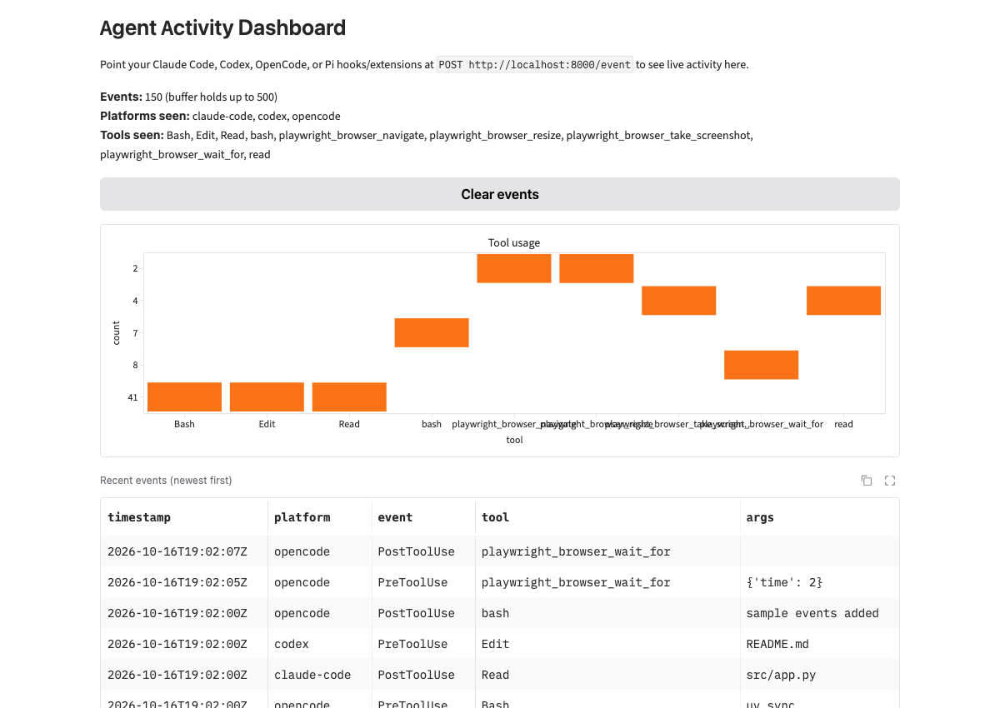

# Agent Activity Dashboard

A live dashboard that visualizes agent (Claude Code, Codex, OpenCode, Pi) tool activity over HTTP. Tool hooks/extensions POST events to this server and see real-time usage in a Gradio UI backed by FastAPI.



## How it works

- `POST http://localhost:8000/event` — receivers for all platforms; payloads are normalized to a shared shape (`platform`, `event`, `tool`, `args`) and kept in an in-memory ring buffer (500 events max)
- `GET http://localhost:8000/health` — liveness + current event count
- `/` (browser) — live Gradio UI with event table, tool usage bar chart, and summary; refreshes once per second via `gr.Timer`

## Run it

Python is managed with [uv](https://docs.astral.sh/uv/):

```sh
uv sync                  # install pinned deps from uv.lock into .venv
uv run agent-dashboard   # serve on HOST/PORT (default 0.0.0.0:8000)
```

Then open <http://localhost:8000>.

Or with Docker:

```sh
docker build -t agent-dashboard .
docker run --rm -p 8000:8000 agent-dashboard
```

## Wiring up opencode

This repo ships an opencode plugin at `.opencode/plugins/dashboard.ts` that streams every tool execution and session event to the dashboard:

```ts
// .opencode/plugins/dashboard.ts
const URL = process.env.DASHBOARD_URL ?? "http://localhost:8000/event";
```

It is auto-discovered by opencode (no config entry needed). TypeScript resolution is handled by `.opencode/tsconfig.json`.

Other platforms: point their hooks (Claude Code `PreToolUse`/`PostToolUse`/`Stop`, Codex, Pi) at `POST http://localhost:8000/event` with a JSON body; unknown shapes are normalized via fallbacks (`hook_event_name`, `tool_name`, `tool_input`, `x-platform` header).

## Project layout

| Path | Purpose |
| --- | --- |
| `app.py` | FastAPI receiver + mounted Gradio UI (single process) |
| `pyproject.toml` / `uv.lock` | Python deps managed by uv; `[project.scripts]` provides `agent-dashboard` |
| `Dockerfile` / `.dockerignore` | uv-based container build |
| `.opencode/plugins/dashboard.ts` | opencode plugin streaming tool events |
| `requirements.txt` | legacy file, superseded by uv (kept for reference) |
